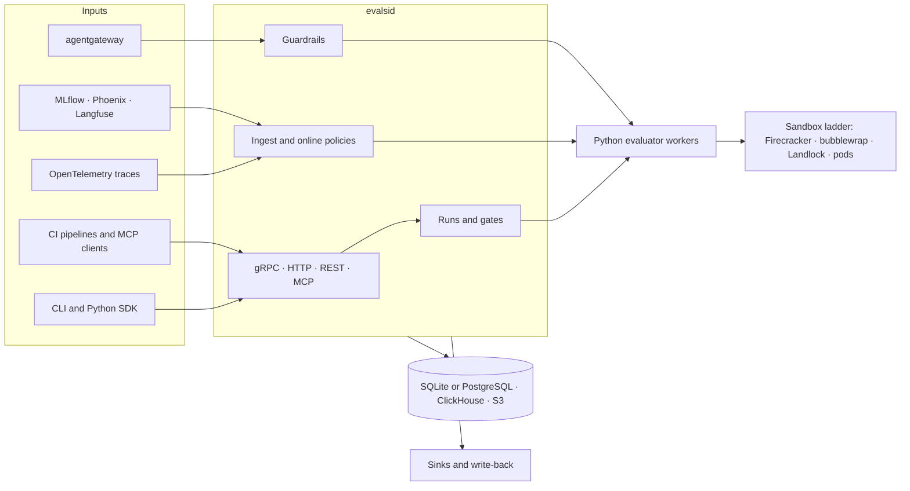

<div align="center">

# Evals.si

**Evaluate AI before you ship, while it runs, and as you train it.**

Agents, RAG pipelines, LLMs and models on one set of evaluators: sandboxed runs and CI gates, live trace scoring, and RL rewards for training. Built first for agents. Pluggable, sandboxed and self-hosted, from a laptop to Kubernetes.

[](https://github.com/Abhishek-Rnjn/Evals.si/actions/workflows/ci.yml)
[](https://evalsi.dev/)
[](https://pypi.org/project/evalsi/)
[](LICENSE)


[Documentation](https://evalsi.dev/) ·
[Quickstart](#quickstart) ·
[Guides](#documentation) ·
[Examples](examples/) ·
[Product roadmap](docs/PRODUCT-ROADMAP.md) ·
[Technical status](docs/LEFTOVERS.md)

</div>

---

Evals.si evaluates an AI system across its life. **Before you ship**, it runs agents, RAG pipelines and models on datasets and sandboxed tasks, and fails the build when a gate fails. **While it runs**, it scores live traces as they arrive and writes the scores back to the MLflow, Phoenix or Langfuse your team already uses. **As you train it**, the same evaluators become RL rewards and checkpoint checks for fine-tuning. One set of evaluators serves all three, so a metric means the same thing in CI, in production and in training.

## Try it in 30 seconds

No clone, no server and no API key. You need Python 3.11+.

### An agent

Score two recorded agent runs on their tool calls:

```bash
pip install evalsi
cat > agent-runs.jsonl <<'JSONL'
{"id": "refund-ok", "input": "Refund order 42", "output": "Refunded order 42.", "reference": {"tool_calls": [{"name": "lookup_order", "arguments": {"id": 42}}, {"name": "refund", "arguments": {"id": 42}}]}, "trajectory": {"steps": [{"type": "tool", "name": "lookup_order", "input": {"json": {"id": 42}}, "output": {"text": "paid"}}, {"type": "tool", "name": "refund", "input": {"json": {"id": 42}}, "output": {"text": "ok"}}]}}
{"id": "refund-loop", "input": "Refund order 7", "output": "Sorry, I could not do that.", "reference": {"tool_calls": [{"name": "lookup_order", "arguments": {"id": 7}}, {"name": "refund", "arguments": {"id": 7}}]}, "trajectory": {"steps": [{"type": "tool", "name": "lookup_order", "input": {"json": {"id": 7}}, "error": "timeout"}, {"type": "tool", "name": "lookup_order", "input": {"json": {"id": 7}}, "error": "timeout"}, {"type": "tool", "name": "lookup_order", "input": {"json": {"id": 7}}, "error": "timeout"}]}}
JSONL
evalsi eval --data agent-runs.jsonl --evaluators tool-call-accuracy,tool-errors,loop-detection
```

```text
2 records · 3 evaluators

metric                        n  mean   95% CI          skipped  errors
tool-call-accuracy.recall     2  0.750  [0.000, 1.000]        0       0
tool-call-accuracy.precision  2  0.667  [0.000, 1.000]        0       0
tool-errors                   2  0.500  [0.000, 1.000]        0       0
loop-detection                2  0.500  [0.095, 0.905]        0       0
```

The first run made both expected calls. The second called `lookup_order` three times in a row, failed each time and never refunded. The table shows what that does to each metric, and how wide the interval is with two runs.

### A RAG pipeline

Check a RAG pipeline's recorded answers, then gate on them:

```bash
cat > rag.jsonl <<'JSONL'
{"id": "refund-window", "input": "How long is the refund window?", "output": "Refunds are accepted for 30 days [1].", "context": ["Our policy allows refunds within 30 days of purchase.", "Shipping takes 3-5 business days."], "reference": "30 days"}
{"id": "shipping-time", "input": "How long does shipping take?", "output": "Shipping takes 3-5 business days [4].", "context": ["Our policy allows refunds within 30 days of purchase.", "Shipping takes 3-5 business days."], "reference": "3-5 business days"}
JSONL
evalsi eval --data rag.jsonl --evaluators citation-accuracy
```

```text
2 records · 1 evaluator

metric             n  mean   95% CI          skipped  errors
citation-accuracy  2  0.500  [0.095, 0.905]        0       0
```

The second answer cites passage `[4]`, but only two passages were retrieved. Add a judge and the `faithfulness`, `answer-relevance`, `context-precision` and `context-recall` metrics tell you whether retrieval or generation is at fault ([guide](docs/guides/evaluate-rag.md)).

For the unreleased setup commands and maintained GitHub Action, see [guided setup](docs/guides/onboarding.md).
For unreleased dataset version review and digest-pinned runs, see [dataset snapshots](docs/guides/dataset-snapshots.md).
Validate the evaluator itself with unreleased [judge calibration](docs/guides/judge-calibration.md): freeze human labels, select prompts/models/thresholds on tuning cases, then measure held-out validity and fresh-call repeatability. Try the [offline example](examples/judge-calibration/README.md).
Turn production incidents into reviewed regression cases with the unreleased [failure inbox](docs/guides/failure-inbox.md), then share [approved immutable dataset versions](docs/guides/dataset-catalog.md) and pin them in server runs. Compare a candidate with a reviewed baseline using [enforced release decisions](docs/guides/release-decisions.md), or configure and investigate the check in the unreleased [browser release workbench](docs/guides/release-workbench.md). Start an agent suite from the unreleased [support and refund starter](docs/guides/support-refund-suite.md): synthetic tasks graded on the final state of a simulated shop.

Next: [gate an agent in CI](docs/guides/gate-an-agent-in-ci.md) (free and offline, with a failing gate and a GitHub Actions workflow), [evaluate a RAG pipeline](docs/guides/evaluate-rag.md), [run an agent on sandboxed tasks](docs/guides/agent-runs.md), [score live traces](docs/guides/trace-sources.md), [train with evaluators as rewards](docs/guides/fine-tuning.md), or [score plain model outputs](#quickstart). The docs are at [evalsi.dev](https://evalsi.dev/).

## What you can evaluate

Agents come first, because that is where evaluation is hardest. RAG and training are first-class too, and the evaluators are shared, so what you learn on one carries to the others.

### Agents

Evals.si ships its own [agent harness](docs/guides/built-in-harness.md) (record and replay, sub-agents, fault injection, versioned profiles). Put the built-in agent, or your own over A2A, MCP, HTTP, an OpenAI Responses API or a CLI, to work on sandboxed tasks, including SWE-bench, τ-bench, Terminal-Bench and BFCL. A hidden checker grades the end state, and evaluators score tool calls, trajectories, loops, step budgets, policy violations and the diff. Trials give pass@k and pass^k, and gates fail the build when an agent gets worse. In production, score traces from LangGraph, CrewAI, the OpenAI Agents SDK, LlamaIndex and the Claude Agent SDK.
[Gate an agent in CI](docs/guides/gate-an-agent-in-ci.md) · [Evaluate a RAG pipeline](docs/guides/evaluate-rag.md) · [Agent runs](docs/guides/agent-runs.md) · [Agent frameworks](docs/guides/agent-frameworks.md) · [Multi-service tasks](examples/multi-service/README.md) · [Harness² runs](docs/guides/harness2.md)

### RAG

Retrieval and generation fail differently, so they are scored separately: `context-precision` and `context-recall` for retrieval, `faithfulness` and `answer-relevance` for generation, and `citation-accuracy`, which needs no judge. Use the built-in metrics, or RAGAS and DeepEval's, through a judge you choose, including a model you host. Gate a pipeline in CI on its recorded answers, and read every mean with its confidence interval.
[Evaluate a RAG pipeline](docs/guides/evaluate-rag.md) · [DeepEval and JevEval](docs/guides/deepeval.md) · [Example](examples/rag/)

### Training and fine-tuning

Evaluators become RL rewards for TRL, verl and OpenRLHF: format checks, math equivalence, sandboxed code tests and served reward models, composed by a `RewardSpec` into one reward per rollout with a breakdown per component. Every saved checkpoint is evaluated against your run specs, compared with the base model record by record, and regression gates fail on significant drops.
[Fine-tuning and RL](docs/guides/fine-tuning.md) · [Example](examples/finetuning/)

## How it fits with other tools

Evals.si does not replace metric libraries and benchmarks. It runs them, and adds what they leave to you: running targets, gating, live scoring and isolation.

| You want | Use |
|---|---|
| A library of metrics inside your own test suite | [DeepEval](docs/guides/deepeval.md) or RAGAS (both also run here as adapters) |
| Standard benchmarks and harnesses | lm-evaluation-harness or Inspect AI (both also run here as adapters) |
| An agent run on sandboxed tasks, graded on the end state, with pass/fail gates for CI and deploys | **Evals.si** |
| RAG metrics split into retrieval and generation, as a gate in CI | **Evals.si** |
| Scores on live traffic, written back to your trace store (MLflow, Phoenix, Langfuse) | **Evals.si** |
| RL rewards and checkpoint regression checks from the same evaluators | **Evals.si** |
| Untrusted evaluator or agent code in a sandbox, self-hosted or air-gapped | **Evals.si** |

If you only need a handful of metrics in a pytest file, a metric library alone is simpler. Evals.si is for when evaluations become a pipeline.

## Highlights

- **Before, during and after.** Gate a pull request or a deploy, score live traces as they arrive, and reward or check a model as it trains, all with the same evaluators and the same metric definitions.
- **Built first for agents.** Sandboxed tasks, a hidden checker, tool-call and trajectory evaluators, pass@k and pass^k over trials, and gates that fail the build ([guide](docs/guides/gate-an-agent-in-ci.md)).
- **RAG, scored where it breaks.** Retrieval and generation metrics side by side, with or without a judge, plus RAGAS and DeepEval ([guide](docs/guides/evaluate-rag.md)).
- **Training, not only testing.** Evaluators as RL rewards for TRL, verl and OpenRLHF, and checkpoint checks against the base model ([guide](docs/guides/fine-tuning.md)).
- **Works with your trace store.** Push OpenTelemetry (OTel GenAI, OpenInference, OpenLLMetry, MLflow), or let a trace source read MLflow, Phoenix, Langfuse, LangSmith or Collector ClickHouse tables and write the scores back to that store.
- **Four ways in.** **Run** an agent, a model or a RAG pipeline on a dataset with trials, gates and budgets, **Watch** live traces with online policies, **Score** outputs you already have, and **Reward** RL training.
- **Pipeline controls.** Upload JSONL/Parquet datasets, retry keyed API writes without repeating execution, delete finished runs to recover quotas, or schedule bounded UTC trace-query windows as batch reports. See [pipeline contracts](docs/guides/integrate-an-agent-harness.md#5-pipeline-writes-datasets-and-retention) and [scheduled pulls](docs/guides/trace-sources.md#scheduled-batch-reports).
- **Pluggable.** lm-evaluation-harness, Inspect AI, RAGAS and DeepEval run as isolated adapters; your own evaluators are Python functions or sandboxed Wasm modules. DeepEval brings 30 metrics for RAG, agents, safety and conversations, including G-Eval and JevEval.
- **Judges you choose, including your own.** Use Claude, OpenAI or any OpenAI-compatible server. JevEval's questions can be answered by a model you serve on vLLM, SGLang or Ollama, with the probabilities read off its token logprobs ([guide](docs/guides/deepeval.md)).
- **Honest numbers.** Every mean has a confidence interval. Records an evaluator can't judge are skipped, never scored as zero, and evaluator failures are errors. There is no default judge, so nothing is billed by surprise.
- **Fails closed.** Untrusted code runs in Firecracker microVMs where available, else bubblewrap or Landlock, else hardened pods, and never with weaker isolation than asked.
- **Runs in your environment.** A single binary, or Helm charts and an operator with CRDs. Self-hosted and air-gappable, with your own models, storage, identity and secrets.

## Install

Each release publishes (see the [Kubernetes guide](docs/guides/kubernetes.md#installing-a-release-and-verifying-it) to verify the signatures):

- **Server and CLI binaries:** Linux amd64 and arm64 archives on the [releases page](https://github.com/Abhishek-Rnjn/Evals.si/releases).
- **Python:** `pip install evalsi` (SDK and CLI) and `pip install evalsi-harness` (the agent harness) from PyPI; the same wheels and sdists are attached to the release. Since v0.2.0, releases also publish Linux (amd64, arm64) platform wheels that carry `evalsid` and its sandbox's `bwrap`, so `evalsi serve` and code evaluators need nothing else; v0.1.0 and other platforms get the pure-Python wheel and a separate `evalsid`.
- **Kubernetes:** multi-architecture images at `ghcr.io/abhishek-rnjn/evalsi` and the three Helm charts as OCI artifacts, `oci://ghcr.io/abhishek-rnjn/charts/evalsi`, `evalsi-crds` and `evalsi-sandboxd`.

To try it from source, use the quickstart below.

## Quickstart

You need [uv](https://docs.astral.sh/uv/) (it installs Python 3.11+ for you). Running the server also needs [Go](https://go.dev/dl/) 1.26+. On Linux, the sandbox for code evaluators needs bubblewrap (see [Development](#development)).

```bash
git clone https://github.com/Abhishek-Rnjn/Evals.si && cd Evals.si
cd python && uv sync --all-packages
uv run evalsi eval --data ../examples/quickstart/qa.jsonl --evaluators exact-match,numeric-match,latency
```

```text
6 records · 3 evaluators

metric         n  mean     95% CI              skipped  errors
exact-match    6  0.333    [0.097, 0.700]            0       0
numeric-match  3  0.667    [0.208, 0.939]            3       0
latency        6  517.500  [276.409, 758.591]        0       0
```

Records that lack what an evaluator needs (here, a numeric reference) are **skipped**, never scored as zero. Failures in the evaluator or judge are reported as **errors** and excluded from the metrics. Use `--cluster-by <metadata key>` when records are correlated.

### Add a judge

There is no default judge. Configure one explicitly:

```bash
# Any OpenAI-compatible server: vLLM, Ollama, LiteLLM, an AI gateway, OpenAI itself
uv run evalsi eval --data ../examples/quickstart/qa.jsonl --evaluators exact-match,llm-judge \
  --judge-model my-judge --judge-base-url http://localhost:8000/v1

# Claude, through the official SDK (installed by the `anthropic` extra)
uv run evalsi eval --data ../examples/quickstart/qa.jsonl --evaluators llm-judge \
  --judge-provider anthropic --judge-model claude-opus-5-5 --param llm-judge.rubric=helpfulness
```

Judge responses are cached by content hash, so re-running an unchanged evaluation costs nothing. Pass `--no-cache` to force fresh calls.

A judge served on vLLM, SGLang or Ollama can also give its decisions as probabilities read off its token logprobs, rather than as text. JevEval's questions use this with `decisions: logprobs`; see the [DeepEval and JevEval guide](docs/guides/deepeval.md).

### From Python

```python
import evalsi
from evalsi import Record, Score, evaluator

@evaluator(name="acme/polite", version="1.0.0")
def polite(record: Record) -> Score:
    return Score(passed="please" in record.output.as_text().lower())

result = evalsi.evaluate("qa.jsonl", ["exact-match", polite])
print(result.table())
result.save("results.json")   # manifest, summaries and every per-record result
```

`evalsi catalog` lists every installed evaluator and its params.

### As a server

`evalsid` serves the same evaluators over gRPC, gRPC-Web, HTTP/JSON and REST on one port, and runs the Python evaluators in a supervised worker.

```bash
go build -o bin/evalsid ./cmd/evalsid        # from the repository root
cd python && uv sync --all-packages
EVALSID=../bin/evalsid uv run evalsi serve --config ../examples/server/evalsi.yaml
```

```python
from evalsi.client import Client

with Client("http://localhost:8080") as client:          # API key from EVALSI_API_KEY
    print(client.evaluate("qa.jsonl", ["exact-match"]).table())
```

`Client.evaluate()` returns the same result as in-process `evalsi.evaluate()`, intervals included; `evaluate_async()` and `evaluate_stream()` (with `evalsi[grpc]`) don't block. REST lives under `/v1alpha1` (`POST /v1alpha1/evaluate`, `POST /v1alpha1/runs`, `GET /v1alpha1/traces/{trace_id}`, `GET /v1alpha1/scores` for online scores per trace and label, …; the full list is in `internal/server/rest.go`), and gRPC reflection is on.

On loopback with no `auth` section the server runs without authentication; on any other address it requires it unless you pass `--no-auth`. The example's judge is Claude: export `ANTHROPIC_API_KEY` first, or `llm-judge` reports errors (never zeros). To try API keys, roles and the audit log locally, use [`examples/auth/local.yaml`](examples/auth/local.yaml) and the [identity guide](docs/guides/identity.md).

## A tour

### Runs and CI gates

A run spec generates outputs from a target, scores them and checks gates. The same file runs embedded, on a server, or as a Kubernetes `EvalRun`:

```bash
uv run evalsi run -f ../examples/runs/capitals.yaml                               # embedded
uv run evalsi run -f ../examples/runs/capitals.yaml --server http://localhost:8080
uv run evalsi compare --server http://localhost:8080 <baseline-run> <candidate-run>
```

`trials: 3` adds pass@3 and pass^3, gates fail the command with exit code 3 (so CI fails), and budgets cap tokens. Server runs are durable: a run interrupted by a restart resumes without redoing finished work. A project can subscribe to signed [webhooks](docs/guides/webhooks.md) for finished runs, failed gates, scored traces and alerts. See [`examples/ci`](examples/ci/) for a pull-request gate.

### Agent runs on sandboxed tasks

Each task gets its own environment: an OCI image, files, setup and a sandbox policy. The agent works in it, a checker grades the end state, and evaluators score the trajectory and the diff.

```bash
uv run evalsi run -f ../examples/agents/swebench-verified.yaml --server http://localhost:8080
uv run evalsi promote <run> --dataset regressions --when 'scores["task-success"] < 1' --server http://localhost:8080
```

`swebench://`, `taubench://`, `harbor://`, `terminal-bench://` and `bfcl://` datasets are graded by each benchmark's own code. The harness adds MCP tools, mocks and fault injection, a simulated user, and record and replay. See the [agent runs guide](docs/guides/agent-runs.md).

### Online evaluation of live agents

Send traces to the server's OTLP endpoint, or read them from where they already are, then apply a policy: a CEL selector, deterministic sampling, cascades (the judge runs only after cheap checks pass), windowed alerts, and promotion of bad traces into datasets.

```bash
uv run evalsi policy apply -f ../examples/watch/support-policy.yaml --server http://localhost:8080
uv run evalsi source apply -f ../examples/sources/studio-mlflow.yaml --server http://localhost:8080
```

| Framework | Tested instrumentations |
|---|---|
| LangGraph / LangChain | OpenInference, LangSmith's OTel export, MLflow autolog |
| CrewAI | MLflow autolog, OpenInference, OpenLLMetry |
| OpenAI Agents SDK | OpenInference, OpenLLMetry |
| LlamaIndex | OpenInference |
| Claude Agent SDK | OpenInference, Claude Code's own traces |

Each row is a real run of the framework, checked in and tested; the [agent frameworks guide](docs/guides/agent-frameworks.md) has the setup and what each instrumentation records. [Trace sources](docs/guides/trace-sources.md) read MLflow, Phoenix, Langfuse, LangSmith or Collector ClickHouse tables (history included), score the traces, and write back assessments, annotations, feedback or companion score rows. The [ClickHouse source](docs/guides/trace-sources.md#clickhouse) supports the Collector Map schema and latest-score queries with `FINAL`; it passed bounded live checks on ClickHouse 25.8.33.6. Self-hosted Langfuse 4.56.0 passed the recorded two-stage check; Databricks numeric-experiment bearer-token downloads are built and contract-tested, not live-verified. LangSmith has server/worker fixture coverage and an [opt-in live check](docs/guides/trace-sources.md#verify-your-langsmith-deployment); live verification still needs credentials. To add Evals.si to an agent platform, follow the [integration guide](docs/guides/integrate-an-agent-harness.md) and the [reference demos](examples/demo/README.md), which evaluate Deep Agents and DeepSeek Harness agents end to end.

### Evaluators and adapters

| Pack | Evaluators |
|---|---|
| `core` | exact, contains, fuzzy, numeric and regex match; JSON validity and schema; length; latency; token usage; cost |
| `judge` | `llm-judge` with rubrics |
| `text` | BLEU, corpus BLEU, ROUGE-1/2/L, chrF, token F1 |
| `rag` | faithfulness, answer relevance, context precision and recall, citation accuracy |
| `safety` | PII, secret and canary leaks; refusal; harmlessness |
| `agent` | tool-call accuracy, trajectory match, tool errors, loop detection, step budget, goal completion; task success (pass@k, pass^k), code quality, policy violations, efficiency |
| `code` | unit tests run in the sandbox, Python syntax |
| `rl` | verifiers for RL rewards: format, math answers, sandboxed code tests, overlong penalty, reward models |
| `finetune` | diversity, calibration, contamination, reward hacking |
| `ml-classic` | classification, regression and ranking metrics |
| `ml-monitoring` | drift (PSI, KS, Jensen-Shannon), data quality, group fairness |

DeepEval, RAGAS, Inspect AI and lm-evaluation-harness, and the SWE-bench, τ-bench and BFCL benchmarks, live in [`python/adapters`](python/adapters/README.md), each in its own pinned environment. The [DeepEval guide](docs/guides/deepeval.md) covers its 30 metrics for RAG, agent traces, safety and conversations. It also covers G-Eval and JevEval, metrics you define as criteria or as weighted questions, whose decisions can come from a model you host. Community evaluators can be [Wasm modules](docs/guides/plugins.md) with no filesystem, network or clock, installed from a plugin index.

### Kubernetes

```bash
kubectl create namespace evalsi
helm install evalsi-crds deploy/helm/evalsi-crds --set operator.namespace=evalsi
helm install evalsi deploy/helm/evalsi -n evalsi
kubectl apply -n evalsi -f examples/runs/capitals.yaml
kubectl get evalruns -n evalsi      # PHASE, RUN, DONE, TOTAL
```

An operator with `EvalRun`, `OnlineEvalPolicy`, `TraceSource`, `Evaluator` and `SandboxClass` resources, validated on admission. Also included:
- PostgreSQL, ClickHouse and S3 storage;
- NATS work queues with KEDA scaling;
- HA replicas, sandbox pools, service-account identity;
- an air-gapped bundle;
- a namespace-only install for clusters without cluster-admin.

See the [Kubernetes guide](docs/guides/kubernetes.md).

### And more

| | |
|---|---|
| [Identity and access](docs/guides/identity.md) | OIDC (Keycloak, Entra ID, Okta, …), API keys, GitHub Actions OIDC, client certificates; project RBAC with custom roles, CEL rules and an audit log |
| [Inline guardrails](docs/guides/guardrails.md) | Redact, evaluate and block LLM and MCP traffic in flight through agentgateway, with an audit mode |
| [Trace redaction](docs/guides/trace-sources.md#trace-redaction) | Mask credential keys on push and pull before storage and evaluation; configurable key globs, regexes and opt-in PII classes |
| [MCP for coding agents](docs/guides/mcp.md) | `evalsi mcp` lets an agent run a suite before and after its change and see what regressed |
| [Human annotation](docs/guides/annotation.md) | Queues with rubrics, annotator agreement, and judge calibration against human labels |
| [Evaluator validation](docs/guides/judge-calibration.md) | Frozen human labels, tuning/held-out judge comparisons, false positives/negatives, repeatability and portable reports (unreleased) |
| [Fine-tuning and RL](docs/guides/fine-tuning.md) | Evaluators as rewards for TRL, verl and OpenRLHF; every checkpoint checked against the base model |
| [Web UI](docs/guides/web-ui.md) | Runs, comparisons, policies, annotation queues, guardrails and the catalog, read through the API |
| Reports and analytics | `evalsi report` (HTML or Markdown), `evalsi analyze` (DuckDB over runs), sinks to MLflow, OpenTelemetry, Langfuse and Phoenix, a Grafana dashboard |

## Architecture



The Go server owns the API, runs, ingest, policies, auth and storage; evaluators run in Python workers (decision [0002](docs/decisions/README.md)). The protobuf API in `proto/` is the single source of truth for gRPC, REST and the CRDs. Read the [architecture and implementation plan](docs/DESIGN.md) and the [decision records](docs/decisions/README.md) for the why.

## Project status

Evals.si is pre-1.0 (the latest release is `0.3.0`). The API is `v1alpha1` and can change between minor versions; see the [changelog](CHANGELOG.md) and [SUPPORT.md](SUPPORT.md) for what that means.

What is verified, in short:
- **Kubernetes:** end-to-end on kind in every CI run (amd64, with Landlock), AKS and an Istio ambient cluster with KVM nodes. [Bounded EKS checks](docs/verification/EKS-2026-10-12.md) passed live KEDA, separate-host NATS broker recovery, pool isolation, application recovery, second-release coexistence, mounted Python/Wasm and managed alert firing/delivery/resolution. Stock admission is blocked by the control-plane/Calico path; an isolated trusted host-network workaround passed. M4 and GKE remain unverified.
- **Trace sources:** MLflow, Phoenix and self-hosted Langfuse 4.56.0 ([two-stage verification](docs/verification/README.md#langfuse-live-recheck-2026-10-10)), and tested profiles for five agent frameworks. The kind job measures a 30-day MLflow backfill and the pull lag of live traces (p95 15 s at a 15 s poll).
- **Agent harness integration:** the kind job deploys the demo workflow through a gate: a regressed release is blocked, a good one goes live, and the default policy scores its executions.
- **RL frameworks:** TRL's `GRPOTrainer` trains with Evals.si rewards on CPU in CI; the rewards also run inside verl's and OpenRLHF's own reward code (no training step there).
- **Web UI:** a browser test runs in CI; desktop/mobile Playwright checks passed against EKS, including recovered results, comparison, filtering, API-key sign-in/sign-out and annotation submit/skip. Real OIDC-provider login remains unverified.
- **Guardrails:** real agentgateway v1.6.0 passed bounded native LLM and MCP request/result pass, mask and block controls; LLM errors failed closed. The upstream model/tool were synthetic; real model calls, streaming behavior and coding-agent products remain unverified.
- **Air-gapped bundles:** one platform per bundle (amd64 by default, `--platform linux/arm64` for arm64); see the [Kubernetes guide](docs/guides/kubernetes.md#air-gapped-installs).

What is deferred or not yet verified is listed in [LEFTOVERS](docs/LEFTOVERS.md), sorted by what each item needs next. Maintainers: see the [release gates and publication procedure](docs/RELEASING.md).

The proposed [product roadmap](docs/PRODUCT-ROADMAP.md) tracks future work for production-agent and enterprise AI teams, with priorities, dependencies and acceptance criteria. The [product strategy](docs/PRODUCT-STRATEGY.md) records the competitive research and adoption plan.

The [pre-0.4 release plan](docs/PRE-0.4-RELEASE-PLAN.md) lists the open product-readiness work for stable 0.4 and the customer-validation criteria that come after it.

[Runtime verification](docs/verification/RUNTIME-VERIFICATION-2026-10-18.md)
tracks real KVM and other remaining prerequisites. The
[competitor benchmark results](docs/verification/COMPETITOR-BENCHMARKS-2026-10-18.md) compare deterministic
local evaluation overhead, with separate limits for hosted platforms.

## Documentation

| Start here | Guides | Reference |
|---|---|---|
| [Documentation site](https://evalsi.dev/) | [Gate an agent in CI](docs/guides/gate-an-agent-in-ci.md) · [Agent runs](docs/guides/agent-runs.md) · [Agent frameworks](docs/guides/agent-frameworks.md) · [Trace sources](docs/guides/trace-sources.md) | [Architecture](docs/DESIGN.md) |
| [End-to-end guide](docs/guides/end-to-end.md) | [Kubernetes](docs/guides/kubernetes.md) · [agentgateway on Kubernetes](docs/guides/agentgateway-kubernetes.md) · [Identity](docs/guides/identity.md) | [Decision records](docs/decisions/README.md) |
| [Examples](examples/) | [Guardrails](docs/guides/guardrails.md) · [MCP](docs/guides/mcp.md) · [Plugins](docs/guides/plugins.md) · [DeepEval and JevEval](docs/guides/deepeval.md) · [Webhooks](docs/guides/webhooks.md) | [Product requirements](docs/PRD.md) |
| [Integrate an agent harness](docs/guides/integrate-an-agent-harness.md) | [Annotation](docs/guides/annotation.md) · [Fine-tuning and RL](docs/guides/fine-tuning.md) · [Web UI](docs/guides/web-ui.md) | [Roadmap and leftovers](docs/LEFTOVERS.md) |

## Repository layout

| Path | What |
|------|------|
| `proto/` | Protobuf API, the single source of truth (`evalsi.v1alpha1`, `evalsi.plugin.v1alpha1`) |
| `gen/go/` | Generated Go code (do not edit; run `make proto`) |
| `cmd/evalsid/`, `internal/` | The Go server: API and REST routes, auth, runs, rewards, OTLP ingest and framework profiles, online policies, trace sources, sandbox, sinks, statistics |
| `python/evalsi/` | Python SDK, CLI, embedded runner, evaluator worker, built-in packs, rewards (`evalsi.rewards`) and checkpoint evaluation (`evalsi.training`) |
| `python/evalsi-harness/` | The agent harness: tool loop, agent connectors, environments and checkers, RL environments, Harbor and Terminal-Bench importers |
| `python/adapters/` | Framework and benchmark adapters, each in its own environment |
| `cmd/evalsi-guest/` | The init and agent inside Firecracker microVMs, and the agent in sandbox pods |
| `cmd/evalsi-operator/`, `operator/` | The Kubernetes operator: CRD types, controllers, admission webhooks |
| `deploy/` | Helm charts (`evalsi`, `evalsi-crds`, `evalsi-sandboxd`), the air-gapped bundle, the kind e2e |
| `tests/` | End-to-end and load tests (`e2e`), chart tests (`helm`), trainer tests (`trainers`), checkpoint-hook tests (`training_hooks`), a browser test of the web UI (`ui`), framework trace recorders (`frameworks`) |
| `examples/` | Runnable examples and the reference demos |
| `docs/` | Design, decision records, requirements, guides and the verification report |
| `website/` | The documentation site |

## Development

You need Go (1.26+), [buf](https://buf.build/docs/installation) and [uv](https://docs.astral.sh/uv/).

```bash
make tools   # protobuf plugins, at the versions CI uses
make proto   # lint, format and regenerate code after editing proto/
make check   # everything CI runs: gofmt, go vet/test, buf lint/format, ruff, mypy, pytest
make e2e     # evalsid against a real Python worker; EVALSI_E2E_IMAGES=1 adds tests that pull images
make adapters-check   # each framework adapter's contract tests, in its own environment
make operator-gen     # regenerate the CRDs and deepcopy code after editing operator/api
```

For the Kubernetes pieces:
- **Operator tests** run against a real API server and etcd (envtest). Install its binaries with `setup-envtest` and set `KUBEBUILDER_ASSETS`; without it, those tests skip.
- **Chart tests** (`tests/helm`) need `helm` on the `PATH`; without it, they skip.
- **Store tests on PostgreSQL:** set `EVALSI_TEST_POSTGRES_DSN` to run `internal/store` against a real database, as CI does. Locking and concurrency fixes are only proved there.
- **The browser test of the web UI** (`tests/ui`) runs the real `evalsid` in Chromium: `cd tests/ui && npm ci && npx playwright-core install chromium`, then `EVALSI_UI_WORKER="$PWD/../../python/.venv/bin/python -m evalsi" npm test`. CI runs it as the `ui-browser` job.
- **The kind e2e** (`deploy/e2e/kind-e2e.sh`) needs Docker, kind, kubectl and helm. It builds the image, makes an air-gapped bundle and installs from it, as the CI `kubernetes` job does.
- **The load test:** `EVALSI_LOAD=1 go test -run TestLoad -timeout 30m ./tests/e2e/`. `EVALSI_LOAD_SPANS` and `EVALSI_LOAD_RUN_RECORDS` set its sizes, and `EVALSI_LOAD_CLICKHOUSE_URL` runs the trace half against ClickHouse.

The sandbox tests need bubblewrap and unprivileged user namespaces. On Ubuntu 24.04, also run `sudo sysctl kernel.apparmor_restrict_unprivileged_userns=0`.

Controlled robustness checks include seeded prompt-injection tool faults, private completion canaries (`evalsi canary create`), and observed trial score diagnostics (`evalsi determinism`). Their scope and follow-ups are recorded in the [implementation review](docs/verification/STACK-101.md).

## Contributing

Issues and pull requests are welcome. [CONTRIBUTING.md](CONTRIBUTING.md) says where things live, what to run before you push and the conventions to follow. Please read the [Code of Conduct](CODE_OF_CONDUCT.md). Report security problems privately: see [SECURITY.md](SECURITY.md). [SUPPORT.md](SUPPORT.md) covers getting help, stability and what has been verified. Changes are listed in the [CHANGELOG](CHANGELOG.md).

## License

[Apache License 2.0](LICENSE).
