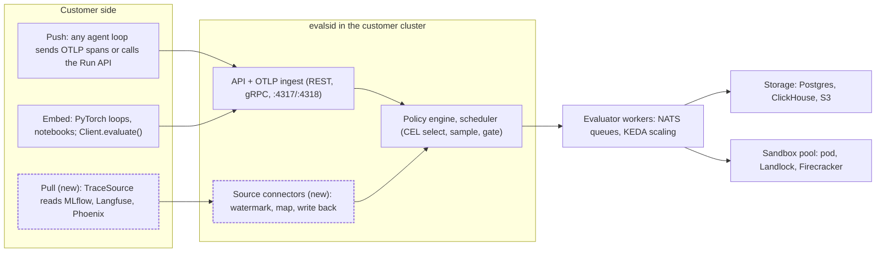
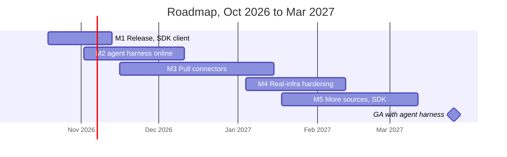

# Evals.si for Customer Kubernetes: Product Requirements

Status: draft · 2026-10-09, status updated 2026-10-13 (after PRs #54 and #56) · Abhishek Ranjan

## Summary

Evals.si becomes an evaluation microservice that customers install in their own Kubernetes cluster and call on demand. It works with any agent loop and any OpenTelemetry trace store; the agent harness is the first integration, and the first cut supports the most popular frameworks and stores. Customers get any evaluation (LLM, RAG, agent, classic ML, RL) through three doors:

1. **Push:** applications send OpenTelemetry traces, or call the API with records, and get scores back.
2. **Pull:** Evals.si subscribes to the customer's existing trace store (first cut: MLflow, Langfuse, Phoenix), evaluates new data as it lands, and writes scores back.
3. **Embed:** a Python SDK call inside a script, notebook or PyTorch training loop, running in-process or against the cluster service.

About 70% of this already ships (Helm charts, operator, OTLP ingest, online policies, run API, in-process SDK, RL rewards). This PRD covers the remaining 30%. Those are pull connectors, an SDK log call, a remote `evaluate()` client, an agent harness integration package and a production release. The target is agent harness evaluating every deployed workflow in its own cluster by **end of Q1 2027**.

## Scope: any agent loop, any trace store

Evals.si is framework-neutral: anything that emits OpenTelemetry spans, or calls the API or SDK, can be evaluated. The first cut adds tested mapping profiles for five popular agent frameworks and pull connectors for three popular trace stores. Everything else still works through the generic paths.

**Agent loops.** Any loop is supported through one of three generic paths: OTel GenAI semantic conventions, OpenInference or OpenLLMetry spans, or `evalsi.log()` and the Run API for loops with no tracing. A mapping profile turns a framework's spans into an Evals.si trajectory (steps, tool calls, model calls, final output). Profiles are tested against fixtures captured from each framework.

| Agent framework | First cut | Instrumentation | Status |
| --- | --- | --- | --- |
| LangGraph / LangChain | Yes | OpenInference, LangSmith OTel export | Tested against recorded traces: OpenInference, LangSmith's OTel export, MLflow autolog ([guide](guides/agent-frameworks.md)) |
| OpenAI Agents SDK | Yes | OpenInference, native tracing processor | Tested: OpenInference, and OpenLLMetry, which records no model output. The native processor exports only to OpenAI, not over OTLP ([guide](guides/agent-frameworks.md)) |
| CrewAI (and the agent harness) | Yes | MLflow autolog, OpenInference, OpenLLMetry | Tested: all three (MLflow needs its OpenAI autolog too; it and OpenLLMetry record no tool spans) ([guide](guides/agent-frameworks.md)) |
| Claude Agent SDK | Yes | OTel GenAI conventions | Tested: OpenInference, and Claude Code's own traces (beta), which record no model output ([guide](guides/agent-frameworks.md)) |
| LlamaIndex | Yes | OpenInference | Tested ([guide](guides/agent-frameworks.md)) |
| AutoGen, Pydantic AI, Google ADK, Semantic Kernel | Later (generic path works today) | OTel GenAI conventions | Not tested |
| Custom loop, PyTorch or RL rollout | Generic path | `evalsi.log()`, Run API, in-process SDK | Built: Run API, SDK and `evalsi.log()` (P5) |

**Trace stores.** OTLP is a push protocol, so any OTLP-compatible store (Tempo, Jaeger, Datadog, Honeycomb, Elastic) is covered by teeing the customer's OTel Collector to evalsid; no connector is needed. Pull connectors are for stores that keep LLM traces behind their own API, where customers also want scores written back into the UI they already use.

| Trace store | First cut (pull and write-back) | Write-back as |
| --- | --- | --- |
| MLflow Tracing (OSS 3.x, Databricks, SageMaker, Azure ML) | Yes | MLflow assessments |
| Langfuse | Yes | Langfuse scores |
| Arize Phoenix | Yes | Phoenix span annotations |
| LangSmith, ClickHouse, Tempo/Jaeger query | Later | Feedback, table rows, none |
| Any OTLP backend | Tee from collector (works today) | OTel `gen_ai.evaluation.result` events |
| Kafka, Kinesis, Pub/Sub, S3 drops | Later | Not applicable |

## Current state

All three doors exist, and v0.1.0 is released. Status is as of `main` on 2026-10-13. An end-to-end verification on kind, AKS and an Istio ambient cluster ([docs/verification/](verification/README.md)) passed most exit criteria, PR #12 fixed most of its findings, and a bounded EKS run ([report](verification/EKS-2026-10-12.md)) checked scaling, broker recovery and restore. Milestone status is under [Milestones](#milestones-and-phased-rollout).

| Capability | Status | Where it lives |
| --- | --- | --- |
| Helm install (`evalsi`, `evalsi-crds`, `evalsi-sandboxd`), namespace-only mode, air-gapped bundle | Built; tested on kind in CI, verified on AKS and an Istio ambient cluster | `deploy/helm/`, `deploy/airgap/` |
| Operator with `EvalRun`, `OnlineEvalPolicy`, `Evaluator`, `SandboxClass` | Built | `operator/` |
| gRPC, HTTP/JSON and REST API; durable, resumable runs | Built | `internal/server/`, `internal/runs/` |
| OTLP trace ingest, online policies (CEL select, sampling, cascades, alerts) | Built | `internal/ingest/`, `internal/watch/` |
| Mapping profiles for the five first-cut agent frameworks | Built; tested against traces recorded from each framework | `internal/ingest/profiles.go`, `tests/frameworks/` |
| evalsi-collector (OTel Collector distribution with redaction) | Built | `deploy/collector/` |
| Score write-back to MLflow, Langfuse, Phoenix, OTel | Built | `internal/sinks/` |
| Evaluator packs (core, judge, text, RAG, safety, agent, code, RL, fine-tune, classic ML, monitoring) and framework adapters | Built | `python/evalsi/src/evalsi/packs/`, `python/adapters/` |
| Agent runs in sandboxes (Firecracker, bubblewrap, Landlock, hardened pod) | Built; all rungs verified on real clusters, Firecracker on a KVM cluster. `mode: bwrap` fails on some hosts (VR-D15) | `internal/sandbox/` |
| In-process `evalsi.evaluate()`, RL rewards (TRL, verl, OpenRLHF), checkpoint evaluation | Built | `python/evalsi/src/evalsi/` |
| OIDC, API keys, project RBAC, CEL rules, audit log | Built | `internal/auth/`, `internal/authz/` |
| Pull connectors for trace stores (MLflow, Langfuse, Phoenix, LangSmith, Tempo, ClickHouse) | MLflow (open source), Phoenix and self-hosted Langfuse 4.56.0 built and verified for the recorded paths; MLflow 30-day backfill and p95 pull lag measured (kind: 300 traces in 6 s, p95 15 s); Databricks and SageMaker built and contract-tested, not run against a real workspace; LangSmith, Tempo and ClickHouse not built | [trace sources guide](guides/trace-sources.md) |
| Log and stream sources (Kafka, CloudWatch, Loki, S3 drops) | Not designed | none |
| `evalsi.log()` SDK call | Built: bounded async OTLP/HTTP, futures and exit flush | [SDK guide](guides/integrate-an-agent-harness.md#sdk-logging-without-otel) |
| Remote `Client.evaluate()` helper | Built (E2), with a parity test against a real `evalsid` | `python/evalsi/src/evalsi/client.py` |
| Scores query API for the agent harness UI (`/v1alpha1/scores`) | Built (A3) | `internal/watch/service.go` |
| Default policy and gated deploys for an agent harness | Built (A1, A2): bootstrap default policy, `evalsi gate`, the demo's `deploy.sh`, run by the kind e2e job; policy templates in `examples/watch/harness-*.yaml` | `python/evalsi/src/evalsi/cli.py`, `examples/demo/` |
| Trace inspection and export | Built: `evalsi traces list`, `get` and `export` (records with scores, by label, policy or time) | `python/evalsi/src/evalsi/cli_traces.py` |
| Runs evaluated elsewhere | Built (E6): `RunService.ImportRun`, `Client.log_run()` | `internal/runs/import.go` |
| Release tag, signed images, published charts | Done: v0.1.0 on 2026-10-12 and v0.2.0 on 2026-10-13, signatures verified ([v0.1.0](verification/README.md#v010-release-record-2026-10-12), [v0.2.0](verification/README.md#v020-release-record-2026-10-13)); see [Releases](#releases) | `.github/workflows/release.yml`, [RELEASING](RELEASING.md) |

## Priority customer: the agent harness

The agent harness is the first application integrated, and every requirement below is ranked by what it needs. It is our own agent-builder application, run on Kubernetes outside any managed platform. Builders design multi-agent workflows (agents, tasks, tools, MCP servers, LLM configs), test them, and deploy each workflow as its own service.

**Confirmed facts** (from the product owner, 9 October 2026):

- Workflows trace to MLflow Tracing (open-source MLflow 3.x, Databricks, or a cloud-managed MLflow).
- Each install is single-tenant: one agent harness per customer, so one Evals.si project per agent harness install.
- Evals.si ships as its own independent Helm chart, installed beside the agent harness the way agent-sandbox is, with an integration guide. It is not a subchart.
- Agents built in the agent harness are evaluated however they can be called: HTTP or gRPC, A2A, or in-process Python once workflows are published as PyPI packages.
- There is no default judge model; the customer configures one.
- Still assumed: the cluster may be air-gapped and run under strict namespace-scoped RBAC.

**What it needs from Evals.si:**

| # | Need | Door | Priority |
| --- | --- | --- | --- |
| A1 | Score every production workflow execution online (task success, tool-call accuracy, loop detection, cost, safety) without code changes in the workflows | Push (OTLP tee) | P0 (Demo built: a bootstrap default policy scores every production trace that names its workflow; the demo service tees OTLP with only environment variables. Not yet run on the real agent harness) |
| A2 | Evaluate a workflow on a test set from the agent harness's "Test" screen before deploying, and block deploy on a failed gate | Push (Run API) | P0 (Demo built: `examples/demo/deploy/deploy.sh` stages, gates and promotes a release, and a failed gate leaves production as it was. Any pipeline can call `evalsi gate`, which gates one release against a candidate URL and exits 3 on a failed gate. Not yet run on the real agent harness) |
| A3 | Show scores inside the agent harness UI, per workflow and per execution, linked to the trace | API + write-back | P0 (Done: API + write-back contract; `GET /v1alpha1/scores`, [guide](guides/integrate-an-agent-harness.md#4-read-the-scores)) |
| A4 | Read traces already stored in its MLflow tracking server, including history from before Evals.si was installed | Pull | P1 (Built: a `TraceSource` backfills, then tails; a 30-day backfill and p95 pull lag are measured in the kind e2e job, [trace sources guide](guides/trace-sources.md#measuring-backfill-and-lag)) |
| A5 | Turn failing production executions into regression datasets, and replay a new workflow version against them | Push + Run API | P1 (Built: a policy's `promote` appends failing traces to a dataset, `evalsi traces export` writes chosen traces as one, and shadow replay re-runs them against a new version; the `harness-default` and `harness-quality` templates promote) |
| A6 | Inline guardrails on tool calls and model calls, in audit mode first | Guardrails | P2 |
| A7 | Install Evals.si from its own chart beside the agent harness, with an integration guide | Deploy | P0 |

## Reference demos: Deep Agents and DeepSeek Harness as the agent harness

Until the agent harness is available for testing, two open-source agent runtimes stand in for the agent harness. Evals.si evaluates agents built on each, in standalone and Kubernetes mode, and these demos are the basis for the docs and the integration guide. [Deep Agents](https://github.com/langchain-ai/deepagents) (LangChain, MIT, built on LangGraph) is the main walkthrough: it is an agent-loop framework like the agent harness's and covers every integration path. [DeepSeek Harness](https://github.com/deepseek-ai/deepseek-harness) (`dsh`, MIT, developer preview) is the second example, an agent loop that is not written in Python.

**Entry points the demos use** (checked against each repository, 9 October 2026):

| Runtime | Entry point | Evals.si use |
| --- | --- | --- |
| Deep Agents | `deepagents` SDK on PyPI | In-process target: a deep agent built in Python, like a PyPI-packaged agent harness workflow |
| Deep Agents | The same agent behind a small HTTP wrapper shipped with the demo | HTTP target, the way a deployed agent harness workflow is called |
| Deep Agents | `dcode` (Deep Agents Code) headless mode | CLI coding agent inside each task's sandbox |
| Deep Agents | `deepagents-acp` | ACP target |
| Deep Agents | MLflow LangChain autolog | Traces land in MLflow and are scored through the MLflow pull connector or an OTLP tee, as with the agent harness |
| DeepSeek Harness | `dsh --profile headless --json "<task>"` | CLI coding agent in the sandbox; its newline-delimited run events become the trajectory |
| DeepSeek Harness | `dsh --profile acp`, Python SDK | ACP and in-process targets |
| DeepSeek Harness | `dsh web` | Plays the agent harness UI in the Kubernetes demo |

dsh's built-in telemetry does not export session traces. The demo includes a separate opt-in GenAI span plugin; native headless MLflow pull/assessment has run on kind (R6).

**Models.** Both agents run on Anthropic models or any OpenAI-compatible endpoint, chosen by environment. CI uses a deterministic mock model, so it needs no key. The judge for rubric-graded tasks is configured separately, as in every install.

**Task suites**

| Suite | What the agent does | How it is graded |
| --- | --- | --- |
| Small repo fixes | `examples/agents/fix-calc` plus about 10 SWE-bench-style fixtures | Task tests on the end state (`task-success`, pass@k, pass^k), `code-quality` on the diff, `policy-violations`, tool errors, loops, cost |
| Terminal-Bench 2 via Harbor | Terminal tasks through Evals.si's `harbor://` adapter. Deep Agents' own eval suite runs Terminal-Bench 2.0 through Harbor, so results can be compared with theirs | The benchmark's own checker, plus trajectory evaluators |
| Deep research | A question that needs search, notes and a written report, the core Deep Agents use case | `llm-judge` with a research rubric, citation accuracy, step budget, cost |

**Runs on any cluster.** The Kubernetes demo uses only standard resources and the Evals.si charts, with no cloud-specific services, so it runs unchanged on any conformant cluster. kind is the reference, locally and in CI. Storage class, ingress, image registry and node placement are chart values, not assumptions.

| ID | Requirement | Priority | Status |
| --- | --- | --- | --- |
| R1 | Demo images: `evalsi-demo-deepagents` (Python, pinned `deepagents` and `deepagents-code`, HTTP wrapper) and `evalsi-demo-dsh` (Node 22, dsh pinned to a commit); model provider and key from environment | P0 | Built; images build in CI only (not run in the session that wrote them: no Docker) |
| R2 | Trajectory mapping for both: Deep Agents traces (LangGraph spans through MLflow or OTel) and dsh `--json` run events, tested against recorded fixtures | P0 | Built; dsh run events and the Deep Agents MLflow export are tested against recorded fixtures |
| R3 | Run specs under `examples/demo/`, one per agent and suite, identical in standalone and Kubernetes mode | P0 | Built; six specs, loaded and checked by tests |
| R4 | Standalone walkthrough: `evalsi run -f ...` embedded, then `--server` against `evalsid serve`, on the bubblewrap rung; report and `/ui/` | P0 | Built; walkthrough in `examples/demo/README.md`, run end to end with the mock model |
| R5 | Kubernetes walkthrough: the Evals.si charts and a sandbox pool, an MLflow server, the Deep Agents HTTP service and `dsh web` as agent harness stand-ins, and `kubectl apply` of the `EvalRun`s; scores in `/ui/` and in MLflow | P0 | Built; chart and overlays are chart-tested. Local kind passed chart installation, dataset upload, both agents' small-repo suites and the MLflow sink; browser walkthrough not rechecked ([verification](verification/README.md#platform-aware-bundle-recheck-2026-10-10)) |
| R6 | Online scoring: Deep Agents traces in MLflow scored by a `TraceSource` (needs M3); a dsh plugin that exports sessions as OTel GenAI spans | P1 | Native headless dsh and Deep Agents loops passed on kind with MLflow 3.17.0 assessment write-back; interactive dsh web export remains unverified ([report](verification/PART-C.md)) |
| R7 | CI: the kind e2e job runs the small-repo-fix suite for both agents against a mock model | P0 | Built; the kind step passed locally for both agents (task-success 1, 33 trials each); not yet run on CI |
| R8 | Portability: chart values for storage class, ingress, image registry and node placement; no cloud-specific dependency | P0 | Built; placement values on every pod and Service, overlays for kind, tainted nodes and Istio ambient, chart-tested |
| R9 | Integration guide `docs/guides/integrate-an-agent-harness.md`, built on these demos and covering the steps the agent harness will follow: install, connect traces, gate deploys, read scores | P0 | Built |

Both runtimes change quickly, and dsh warns of breaking changes, so the demos pin versions and the CI job (R7) catches drift when a pin moves.

## Goals, non-goals and success metrics

**Goals**

- G1. One `helm install` gives a customer a production-grade evaluation service in their own cluster, with no data leaving it.
- G2. Any evaluation the catalog supports can be run three ways (push, pull, embed) with identical scores.
- G3. The agent harness evaluates every deployed workflow online and gates every deploy offline.
- G4. Customers bring their own evaluators, judges, models, storage and identity.

**Non-goals**

- A hosted SaaS version of Evals.si (this PRD is self-hosted only).
- Replacing the customer's observability tool. Evals.si scores traces and writes back; it does not become their trace UI.
- Building a trace store for logs that have no LLM or agent content.
- Training or hosting judge models.

**Success metrics**

| Metric | Target | How measured |
| --- | --- | --- |
| Time from `helm install` to first score in the agent harness | under 30 minutes | Install runbook timed on a fresh kind and EKS cluster |
| Share of production workflow executions scored by at least one policy | 100% sampled at policy rate, no drops | `evalsi policy stats` vs. ingested trace count |
| Online scoring delay, trace end to score written back (cheap evaluators) | p95 under 30 s | evalsid `/metrics` histogram |
| Pull connector lag behind source | p95 under 2 min | Watermark age metric per source |
| Same records scored via push, pull and embed | Identical scores and intervals | Parity test in CI |
| Deploys in the agent harness that run a gate | 100% of production deploys | Agent harness deploy audit log |
| Scale | 10k traces/min ingest, 1k concurrent agent trials | Load test on a sized cluster |

Measured so far (2026-10-13, [record](verification/README.md#agent-harness-gate-and-trace-source-measurement-2026-10-13)), none at production scale: pull lag p95 15 s against the 2-minute target, with a 30-day MLflow backfill of 300 traces in 6 s (kind e2e job, `scripts/measure-trace-source.py`); every deploy of the demo workflow runs a gate, and a regressed release is blocked (kind e2e job); push and embed parity (`Client.evaluate()` against in-process) is tested in CI. Install-to-first-score time, online scoring delay and scale have not been measured.

## Personas and user journeys

| Persona | Wants | Touches |
| --- | --- | --- |
| Platform engineer | Install, upgrade, secure and scale Evals.si like any other cluster service | Helm values, CRDs, Grafana, RBAC |
| Workflow builder (agent harness user) | Know whether a workflow is good before and after deploy, without writing eval code | Agent harness UI: test screen, scores tab, deploy gate |
| ML / AI engineer | Custom evaluators, judges and datasets; compare versions | Python SDK, CLI, run specs, `Evaluator` CRD |
| Researcher in a training loop | Scores and rewards inside a PyTorch loop, local or against the cluster | `evalsi.evaluate()`, `Client.evaluate()`, rewards |
| Data or SRE owner of an existing trace store | Scores on traces they already keep, written back where they look | `TraceSource` CRD, sinks |

**Journey 1: install beside the agent harness (A7).** The platform engineer installs the `evalsi` chart in its own namespace, as they would agent-sandbox, then follows the integration guide. A bootstrap job creates one project for the agent harness install and writes an ingest key and a runner key to Kubernetes Secrets. The agent harness's traces reach Evals.si either through a second OTLP exporter or through a `TraceSource` that pulls from its MLflow server.

1. Evals.si starts in namespace-only mode, with a Landlock or pod sandbox rung.
2. A default `OnlineEvalPolicy` per workflow scores task success, tool errors, loops, cost and PII.
3. The agent harness reads scores over the REST API and shows them per execution.

**Journey 2: gate a deploy (A2).** The builder clicks Deploy. The agent harness creates an `EvalRun` from the workflow's test set with gates (for example `task-success >= 0.8`). The run executes the workflow over HTTP, gRPC or A2A, or in-process from its PyPI package inside a sandbox. A failed gate blocks the deploy and links the report.

**Journey 3: production to regression (A5).** A policy promotes traces with `task-success < 1` into a dataset. The next deploy's gate run includes that dataset, and shadow replay compares the new version against recorded behavior.

**Journey 4: subscribe to an existing store (A4).** The SRE applies a `TraceSource` pointing at the agent harness's MLflow tracking server. Evals.si backfills 30 days, then polls every 30 s, scores with the same policies, and writes scores back as MLflow assessments.

**Journey 5: training loop.** A researcher calls `evalsi.Client(server).evaluate(records, ["llm-judge"])` every N steps, or uses `reward_funcs` from the cluster's Reward Service in GRPO.

## Requirements: deployment as a microservice

Evals.si must install, run and upgrade like any well-behaved cluster service; most of this exists and the gaps are packaging and release.

| ID | Requirement | Priority | Status |
| --- | --- | --- | --- |
| D1 | Install from a versioned OCI Helm chart (`oci://ghcr.io/.../evalsi`) with signed images (cosign keyless) and an SBOM | P0 | Done in v0.1.0 (signatures verified with `scripts/verify-release.sh 0.1.0`, see the [release record](verification/README.md#v010-release-record-2026-10-12)): `release.yml` signs the images and the OCI charts keyless, attaches BuildKit provenance and an SBOM, attests an SPDX SBOM; `scripts/verify-release.sh` verifies them ([guide](guides/kubernetes.md#installing-a-release-and-verifying-it)). The first tag run found and fixed a signing login bug |
| D2 | Installs as an independent chart beside others (agent harness, agent-sandbox): all names prefixed by release, every external dependency (Postgres, NATS, S3, ClickHouse) either bundled or pointed at an existing one | P0 | Built: release-prefixed names, bundled or existing dependencies and `global.imageRegistry` ([guide](guides/kubernetes.md#names-and-installing-beside-other-charts)). Bounded EKS pass: bundled ClickHouse stored redacted records; a full second API/CPU/pool release used a separate database and broker, scored successfully and rejected the original key symmetrically. Two actual pools passed own-pool allow/other-pool deny controls on Calico. Not independent database permissions, two RDS instances, mesh enforcement or every feature under both releases ([evidence](verification/EKS-2026-10-12.md)) |
| D3 | Namespace-only install with Pod Security `restricted`, no cluster-scoped objects | P0 | Built (`values-namespaced.yaml`) |
| D4 | Bootstrap job that creates projects, API keys and default policies from Helm values and writes keys to Secrets | P0 | Built: `bootstrap.*` values run `evalsi-operator bootstrap` as post-install/post-upgrade Jobs ([guide](guides/kubernetes.md#first-state-from-values-the-bootstrap-job)); local arm64 kind key survival passed. EKS bootstrap reran, the original key survived the tested upgrade and authenticated after recovery. The no-deletion second-release fixture disabled auto-deleting hooks and provisioned its project/key through the API; that is not another bootstrap-hook test ([evidence](verification/EKS-2026-10-12.md)) |
| D5 | Horizontal scale: API replicas, KEDA-scaled worker pools per evaluator image, sandbox pools | P0 | Bounded EKS pass: genuine backlog scaled harness workers 0 to 3 Ready and naturally back to 0; production scale remains unverified ([evidence](verification/EKS-2026-10-12.md)) |
| D6 | Health, readiness, `/metrics`, Grafana dashboard, structured logs, OTel self-tracing | P0 | Built |
| D7 | Zero-downtime upgrade with forward-only DB migrations and a documented N-1 compatibility rule | P1 | EKS v0.1.0-to-main upgrade failed with 2/1,781 connection errors; drain fix passed an API-only rollout, 1,799/1,799. Full upgrade and published N-1 compatibility remain uncertified ([evidence](verification/EKS-2026-10-12.md)) |
| D8 | Air-gapped install from one bundle | P1 | Built: one platform per bundle; the bundle and install steps pass on amd64 CI (kind, with Landlock) and on arm64 hosts with Docker 28 and 27 (a Docker without `--platform` for inspect, save and load uses the plain commands) |
| D9 | Mount Wasm and Python evaluator plugins from a volume or an init container | P1 | Bounded EKS pass: chart-mounted Python pack scored by name through live API/CPU; init-populated read-only Wasm volume executed good/bad/skip records and rejected a wrong pin in the stock image. Distributed API Wasm execution and every native dependency ABI remain unverified ([plugins](guides/plugins.md#kubernetes-mounts), [evidence](verification/EKS-2026-10-12.md)) |
| D10 | Backup and restore runbook for Postgres and object storage | P1 | Bounded EKS application recovery passed: separate restored database and MinIO target, original keys authenticate, 32 run records/results/outputs readable, new object-backed run succeeds with original sources unavailable. Bootstrap reran; separate-instance/RDS disaster recovery and RTO/RPO remain unverified ([evidence](verification/EKS-2026-10-12.md)) |
| D11 | Reference values for EKS, GKE, AKS, OpenShift and kind | P2 | All five render; kind installed. EKS was exercised with a bounded trial-specific profile, not an unchanged certified reference profile; GKE/AKS/OpenShift reference profiles remain unverified live ([operations](guides/operations.md), [EKS evidence](verification/EKS-2026-10-12.md)) |

## Requirements: the three integration modes

All three modes feed the same evaluator catalog and policy engine, so a record gets the same score whichever door it came through.

### Push: customers send data to us

| ID | Requirement | Priority | Status |
| --- | --- | --- | --- |
| P1 | OTLP gRPC and HTTP ingest of GenAI, OpenInference and OpenLLMetry spans, project assigned from the ingest credential | P0 | Built |
| P2 | On-demand `Evaluate` and `EvaluateStream` for records sent in the request | P0 | Built |
| P3 | Run API: create, watch, cancel, resume, compare, with gates and budgets | P0 | Built |
| P4 | Webhook callback when a run or a scored trace finishes, signed with HMAC | P0 | Done: `run.finished`, `run.gate_failed`, `trace.scored` (opt-in, one per trace and policy, pushed or pulled), `alert.fired` and `alert.resolved`; `POST /v1alpha1/webhooks` ([guide](guides/webhooks.md)) |
| P5 | `evalsi.log(input, output, trace_id, metadata)` SDK call for apps without OTel, batched and async | P1 | Built, SDK tests and real exit flush pass ([report](verification/PART-C.md)). A failed batch is reported once, exit waits at most `exit_timeout`, a forked child starts clean, and non-finite metadata is sent as text |
| P6 | Bulk upload: POST a JSONL or Parquet file, or reference an S3 object, as a dataset | P1 | Built: bounded JSONL/Parquet upload, project-confined S3 import and content-addressed publication; local validation and real-worker pipeline tested; live S3 import not certified |
| P7 | Idempotency key on every write, so retries from customer pipelines never double-score | P1 | Built for API unary/streaming writes, raw uploads and OTLP exports: durable 24h replay of successes, request conflicts, and uncertain claims that are not re-executed until six days past expiry; a failed call releases its key so a retry runs again; an hourly pass sweeps idle scopes; generated secrets never replay. MCP tool writes and cross-system exactly-once delivery are not covered |

### Pull: we subscribe to customer data sources

This is the largest new build. A new `TraceSource` resource (CRD and API) describes where to read, how to map records, which policies apply, and where to write scores back.

| ID | Requirement | Priority | Status |
| --- | --- | --- | --- |
| S1 | Connector interface: `List(since watermark) -> records + new watermark`, `WriteBack(scores)`; watermark stored per source and resumed after restart | P0 | Built ([guide](guides/trace-sources.md), [0016](decisions/0016-trace-source-connectors.md)) |
| S2 | Connectors for the first-cut trace stores: MLflow Tracing first (OSS 3.x, Databricks, SageMaker, Azure ML), then Langfuse and Arize Phoenix (LangSmith, ClickHouse, Tempo/Jaeger later) | P0 | Partly: MLflow open source (3.17.0), Phoenix (20.20.0), self-hosted Langfuse (4.56.0, two-stage Secret/Service/policy/write-back and enforced egress check); Databricks (numeric experiments with a bearer token; Unity Catalog schemas with OAuth service principals) and SageMaker (SigV4) built and contract-tested against pinned client source, not live-verified; Azure ML refused, as its MLflow server has no V3 trace API ([guide](guides/trace-sources.md), [decision 0016](decisions/0016-trace-source-connectors.md), [verification](verification/README.md#langfuse-live-recheck-2026-10-10)) |
| S3 | Connectors for streams and logs: Kafka, AWS Kinesis, GCP Pub/Sub, S3/GCS prefix watcher; Loki and CloudWatch Logs via the evalsi-collector as recipes | P2 (after first cut) | Gap |
| S4 | Field mapping: CEL or JSONPath from the source record into Evals.si `Record` (input, output, reference, context, trajectory, metadata) | P0 | Built: decoders per store over the existing conventions, plus CEL `overrides` ([guide](guides/trace-sources.md), [0016](decisions/0016-trace-source-connectors.md)) |
| S5 | Backfill a time range, then tail; rate limit per source; at-least-once with dedup on source record ID | P0 | Built: backfill, tail with a `maxTraceDuration` lookback, rate cap, dedup by trace ID and digest ([guide](guides/trace-sources.md), [0016](decisions/0016-trace-source-connectors.md)) |
| S6 | Pulled records reuse `OnlineEvalPolicy` (selectors, sampling, cascades, alerts, promotion) | P0 | Built ([guide](guides/trace-sources.md), [0016](decisions/0016-trace-source-connectors.md)) |
| S7 | Credentials for sources from Kubernetes Secrets or the existing per-project credential store, never in the CRD | P0 | Built: a granted variable or a mounted Secret file (`sources.secrets`), never in the resource ([guide](guides/trace-sources.md), [0016](decisions/0016-trace-source-connectors.md)) |
| S8 | Status on the resource: watermark age, records/s, errors, last write-back | P0 | Built: phase, watermark, lag, counters, last error and write-back on the resource and in metrics ([guide](guides/trace-sources.md), [0016](decisions/0016-trace-source-connectors.md)) |
| S9 | Scheduled pull runs (cron) that evaluate a query window as a batch run with a report | P1 | Built: UTC cron, bounded query snapshots, deadline/missed-window counters, deterministic run IDs and no overlap with the prior run; local real-worker report/restart tests pass. Empty windows have no run; automatic source write-back and cloud failover certification remain outside scope |

### Embed: local scripts, notebooks and training loops

| ID | Requirement | Priority | Status |
| --- | --- | --- | --- |
| E1 | In-process `evalsi.evaluate()` and `aevaluate()` with every built-in pack, no server | P0 | Built |
| E2 | `Client.evaluate(records, evaluators, params)` and `Client.evaluate_stream()` that run on the cluster and return the same `EvaluationResult` type as E1 | P0 | Built: `Client.evaluate()`, `evaluate_async()`, `evaluate_stream()` (gRPC; `evalsi[grpc]`), with a parity test against a real `evalsid` |
| E3 | Tensor-friendly batching: accept lists of dicts, pandas, or Hugging Face datasets; non-blocking futures so a training step never waits | P1 | Built; real tensors/pandas/HF datasets tested; serialization is local and network I/O async ([report](verification/PART-C.md)) |
| E4 | RL rewards from the cluster Reward Service (TRL, verl, OpenRLHF) | P0 | Built |
| E5 | Checkpoint evaluation hooks for plain PyTorch and Lightning (not only Hugging Face `TrainerCallback`) | P1 | Built; actual CPU framework tests in separate environments ([guide](guides/fine-tuning.md#plain-pytorch-and-lightning)); state-dict serving needs a compatible strategy. The PyTorch hook saves and evaluates on rank zero only, and the checkpoint takes the umask's mode |
| E6 | Log results from a local loop to the server as a run, so they show next to cluster runs | P1 | Built: `Client.log_run(result)` stores an in-process result as a finished run (`RunService.ImportRun`), gates checked on the server, webhooks fired; local evaluators the server lacks are kept by name ([guide](guides/fine-tuning.md#logging-a-local-loop-to-the-server)) |

## Architecture and API design

One new component, the source connector manager, sits beside the existing ingest path and feeds the same policy engine; everything else is new API surface on existing services.



Dashed boxes are new in this PRD.

Push and embed already reach the API; pull adds connectors that read customer stores and write scores back, then hand records to the same policies and workers.

### TraceSource resource (new)

Available as a CRD and as `POST /v1alpha1/sources`. The connector manager runs under the same lease as the policy engine, so one replica owns each source.

```yaml
apiVersion: evals.si/v1alpha1
kind: TraceSource
metadata: {name: studio-mlflow, namespace: evalsi}
spec:
  project: agent-harness
  connector: mlflow             # first cut: mlflow | langfuse | phoenix
  endpoint: http://mlflow.agent-harness:5000
  experimentIds: ["1"]
  credentialsSecretRef: {name: mlflow-token}
  backfill: {since: 720h}
  poll: {interval: 30s, maxRecordsPerSecond: 200}
  mapping:                      # CEL over the source trace
    input: 'trace.request'
    output: 'trace.response'
    metadata: {workflow: 'trace.tags["agent_harness.workflow_id"]'}
  policies: [studio-agent-quality]
  writeBack: {enabled: true, as: assessment}
status:
  watermark: "2026-10-09T12:00:00Z"
  lagSeconds: 41
  recordsPerSecond: 37
```

[Decision 0016](decisions/0016-trace-source-connectors.md) revises this shape: `credentials` (a variable or mounted file, never a Secret reference), `profile` plus `overrides` instead of `mapping`, `maxTraceDuration` instead of a single lookback, an `auth` block, and no per-source NetworkPolicy.

### New and changed API surface

| Surface | Change |
| --- | --- |
| `POST/GET/DELETE /v1alpha1/sources`, `POST /v1alpha1/sources/{name}:backfill`, `:pause`, `:resume` | New SourceService |
| `POST /v1alpha1/webhooks` | Subscribe to run finished, gate failed, trace scored, alert fired; HMAC-signed |
| `GET /v1alpha1/traces/{id}/scores`, `GET /v1alpha1/scores?project=&label=&since=` | Query scores per trace, workflow or label, for the agent harness UI. Built as `TraceService.ListScores`: labels are repeated `labels=key=value`, and `service`, `policy`, `evaluator` and paging are filters too |
| `evalsi.Client.evaluate()`, `evaluate_stream()`, `evaluate_async()` | Python wrappers over `EvaluationService` returning `EvaluationResult` |
| `POST /v1alpha1/runs:import`, `Client.log_run()` | `RunService.ImportRun`: store a run evaluated elsewhere (E6) |
| `evalsi gate`, `evalsi traces` | A deploy gate for one release (A2) for pipelines without `kubectl`; list, show and export ingested traces |
| `evalsi.log(input=, output=, trace_id=, metadata=)` | Buffered client that sends OTLP to evalsid |
| Idempotency-Key header on every POST | Dedup retries |

### agent harness integration contract

- **Helm:** Evals.si is an independent chart installed beside the agent harness, like agent-sandbox. The integration guide gives the values for project bootstrap, default policies and the customer's judge.
- **Tracing:** the agent harness already traces to MLflow. Either add evalsid as a second OTLP exporter, or apply a `TraceSource` with `connector: mlflow`. Label traces with `evalsi.label.workflow` and `evalsi.label.version`.
- **Deploy gate:** the agent harness creates an `EvalRun` whose target is the workflow over HTTP, gRPC or A2A, or its PyPI package run in-process in a sandbox, and waits on the run-finished webhook.
- **UI:** the agent harness reads `/v1alpha1/scores` and links each score to `/ui/` for the full report. Scores also appear in MLflow as assessments.

## Security, tenancy and operations

No customer data leaves the cluster unless the customer configures a judge or sink that sends it out. The existing identity and sandbox model covers most of this. New work is for pull connectors and the agent harness tenant mapping.

- **Identity.** API keys, OIDC (including Kubernetes service-account tokens) and mTLS between components, as built. The agent harness authenticates with its pod's projected service-account token; no static key is required.
- **Tenancy.** The agent harness is single-tenant, so it uses one Evals.si project per agent harness install; other customers can use several projects. Ingest keys are bound to one project, so a workflow cannot inject traces into another tenant's policies. Per-project quotas cover runs, judge tokens and pull-source throughput (new).
- **Pull connector egress.** Each `TraceSource` declares its endpoint; a NetworkPolicy generated by the operator allows only that egress. Source credentials are read from Secrets at use time and never logged or returned by the API.
- **Data handling.** Redaction rules apply on ingest and on pull, before storage and before any judge call. Built and locally regression-tested: `traces.redaction` defaults to credential-key masking, with optional key globs, value regexes and PII classes (a card number next to a CVV or expiry is still masked), including source overrides ([guide](guides/trace-sources.md#trace-redaction), [0019](decisions/0019-trace-redaction.md)). Retention per project for traces, records and results, with a hard-delete API for data-subject requests remains a separate requirement.
- **Sandboxing.** Untrusted evaluator code and agent tasks run on the strongest available rung, failing closed. In the namespace-only agent harness install, that is the pod or Landlock rung.
- **Audit.** Every API call, policy change and source change is in the audit log, with the principal and decision.
- **Operations.** SLOs: API availability 99.9%, p95 online score delay under 30 s, pull lag under 2 min. Alerts ship as PrometheusRules in the chart. Runbooks cover a stuck watermark, a judge outage (scores report errors, never zeros), NATS backlog, and DB failover.

## Milestones and phased rollout

The agent harness gets online scoring and deploy gates first (M2, mid-December), because they need no new connectors; pull connectors follow in M3 and GA lands on 26 March 2027. Dates assume two to three engineers and are proposals.



M1 and M2 overlap because M2 needs only the release and the client from M1, not all of it.

**Status on 2026-10-13**

| Milestone | Status | What is left |
| --- | --- | --- |
| M1 Release, SDK client | **Done.** v0.1.0 signed, published and verified (v0.2.0 since); `Client.evaluate()` parity test; webhooks | Nothing |
| M2 agent harness online | **In progress.** A3, A7, R1 to R5 and R7 to R9 built. The default policy (A1) and the gated deploy (A2) are built on the demo: standalone checked (a regressed release exits 3, production traces scored by the default policy), and the kind e2e job runs both | The kind job's pass on CI; sign-off on the real agent harness needs access to its repository (open question below) |
| M3 Pull connectors | **Partly done.** S1, S4 to S8 built; MLflow OSS, Phoenix and Langfuse verified live; R6 passed on kind; a 30-day backfill and p95 pull lag measured by `scripts/measure-trace-source.py` (locally 500 traces in 5 s, p95 15 s; in the kind e2e job) | Databricks and SageMaker against real workspaces; backfill and lag at production scale; scores in each store's UI checked; profiles against real model output |
| M4 Real-infra hardening | **Not certified.** Bounded EKS KEDA, broker recovery and restore passed | 10k traces/min and 1k concurrent trials; a full zero-downtime upgrade and the N-1 rule; node failure; mesh enforcement |
| M5 More sources, SDK | **Split.** P5, E3 and E5 built | LangSmith and ClickHouse connectors, Kafka and S3 sources (S2 later stores, S3); the Kafka question below |
| GA with agent harness | **Not started** | All P0 met, runbooks and SLO alerts, a 4-week external pilot |

### Releases

Releases follow semantic versioning; until 1.0 a minor version may change the `v1alpha1` API. v0.1.0 (2026-10-12) closed M1. v0.2.0 (2026-10-13) is a minor release: it adds the `CheckpointServer` CRD, the `ImportRun`, `SliceRuns` and `ArchiveRun` RPCs, platform wheels and the M2 agent harness pieces (see the [changelog](../CHANGELOG.md)); it was signed, published to GHCR and PyPI and verified ([record](verification/README.md#v020-release-record-2026-10-13)). Fixes for a released version alone would be a patch from a release branch. [RELEASING](RELEASING.md) has the procedure.

**Exit criteria per milestone**

1. **M1 Release, SDK client** (D1, D2, D4, E2, P4): signed `v0.1.0` chart and images published; `Client.evaluate()` returns scores identical to in-process; webhooks fire on run finish.
2. **M2 agent harness online** (A1, A2, A3, A7): Evals.si installs from its own chart beside the agent harness by following the integration guide; every deployed workflow is scored by a default policy; a failed gate blocks a deploy in a demo cluster. The Deep Agents and DeepSeek Harness demos (R1 to R5, R7 to R9) run in standalone mode and on kind, and the integration guide is published.
3. **M3 Pull connectors** (S1, S2, S4 to S8): a `TraceSource` backfills 30 days from MLflow (OSS 3.x, Databricks, SageMaker; Azure ML is dropped for now, as its MLflow server has no V3 trace API, see [decision 0016](decisions/0016-trace-source-connectors.md)), then from Langfuse and Phoenix, and tails with p95 lag under 2 min; scores appear in each store's own UI. Mapping profiles for the five first-cut agent frameworks pass their fixture tests. Deep Agents traces in MLflow are scored online (R6).
4. **M4 Real-infra hardening** (D5, D7, D10): load test of 10k traces/min and 1k concurrent trials on EKS; KEDA and 3-node NATS run live (Firecracker is already verified on a KVM cluster); upgrade from M1 to M4 with no downtime.
  Status on 2026-10-12: **not certified**. Bounded EKS KEDA, separate-host NATS broker recovery and application recovery passed; the full upgrade failed, its drain follow-up was API-only, and production load/concurrent trials were explicitly deferred ([evidence](verification/EKS-2026-10-12.md)).
5. **M5 More sources, SDK** (S2 later stores, S3, P5, E3, E5): LangSmith and ClickHouse connectors, Kafka and S3 sources; `evalsi.log()`; PyTorch and Lightning checkpoint hooks.
6. **GA with agent harness:** all P0 requirements met, runbooks and SLO alerts shipped, one external pilot running for 4 weeks.

## Risks and open questions

| Risk | Impact | Mitigation |
| --- | --- | --- |
| Source APIs (MLflow variants, Langfuse, Phoenix) change or rate-limit pulls | Pull lag, missed records | Version-pinned connectors with contract tests; back off on 429; prefer OTLP tee where the customer can |
| Judge cost grows with production traffic | Surprise bills | Cascades and sampling on by default; per-project token quotas; no default judge |
| Namespace-only installs get only the weakest sandbox rung | Code evaluators slower or unavailable | Pod rung by default; document Firecracker pool as an opt-in cluster add-on |
| Production-scale KEDA/NATS, node-failure HA and sandbox egress under a mesh remain unverified | Incidents at first customer scale | Bounded EKS backlog, broker-process recovery and non-mesh pool controls passed; certify production load and mesh enforcement before GA (M4) |
| The agent harness's MLflow traces differ from the shapes the mapping profiles expect | Agent evaluators skip records | Mapping layer (S4) plus a fixture set captured from real agent harness traces |

**Open questions**

- [x] Trace backend: MLflow Tracing.
- [x] Tenancy: single tenant.
- [x] Workflow invocation: HTTP, gRPC, A2A, or in-process from PyPI.
- [x] Default judge: none; the customer configures one.
- [x] Packaging: an independent chart plus an integration guide.
- [ ] Access to the agent harness repo for the real-cluster test and trace fixtures (planned for that test).
- [ ] Kafka and log sources: built-in connectors, or collector recipes only for v1?
