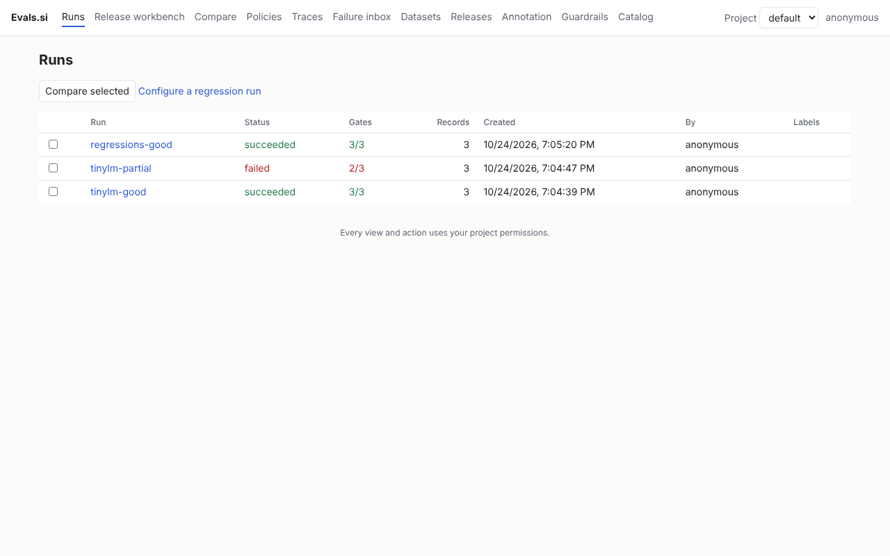
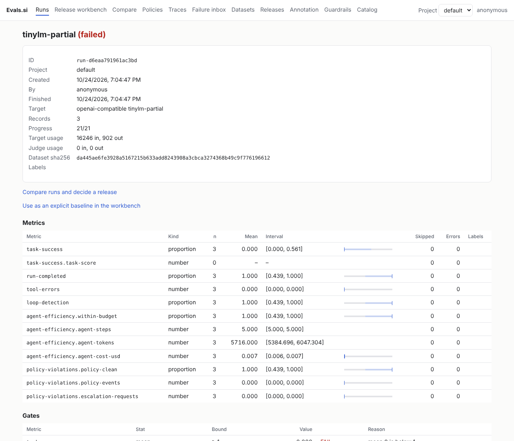
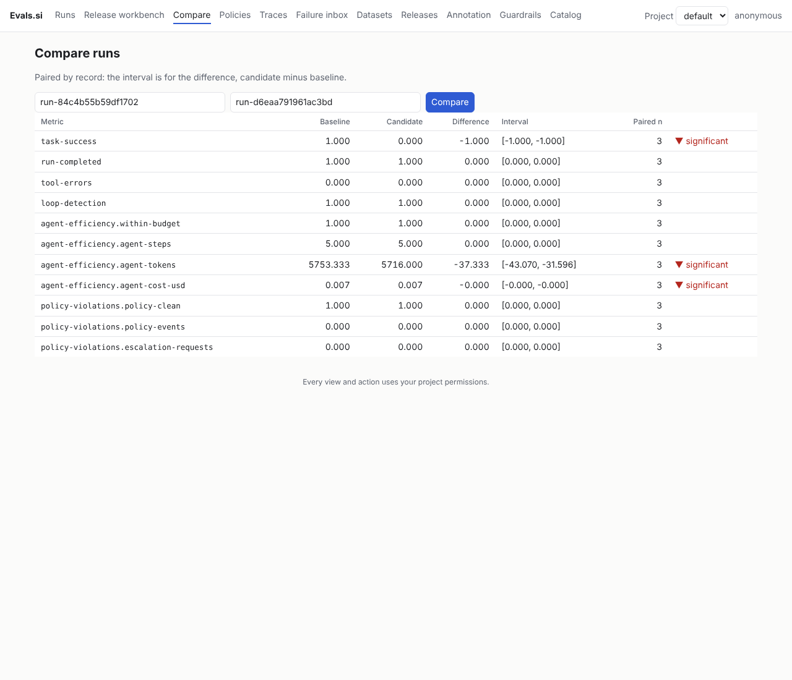

# 8. The server, the UI and a regression loop

So far every run was **embedded**: `evalsi run` built the sandboxes and ran the
evaluators in its own process, and the results lived in a JSON file. The server,
`evalsid`, runs the same specs and keeps every run: you can compare runs, browse
them in a UI, and turn failures into a regression dataset that the next run must
pass. Same spec, one flag.

Keep TinyLM running from [tutorial 3](03-built-in-harness.md).

## Start a server

The Linux wheel already carries `evalsid`, and `evalsi serve` starts it, passing
everything after `serve` through. To see its flags, put `--` first:

```bash
evalsi serve -- -h
```

```text
Usage of serve:
  -config string
    	path to evalsi.yaml (defaults apply when omitted)
  -listen string
    	address to listen on, overriding the config (e.g. 127.0.0.1:8080)
  -no-auth
    	turn authentication and authorization off, for development (also EVALSID_NO_AUTH=1)
```

(In 0.3.1 `evalsi serve --help` fails with `unrecognized arguments: --help`; later
versions forward it to `evalsid`. `-- -h` works in both. See the
[onboarding study](00-onboarding-study.md).)

With no config at all the server starts, but it cannot run our spec yet:

```bash
evalsi serve --listen 127.0.0.1:8080 &
evalsi run -f run.yaml --server http://localhost:8080
```

```text
error: invalid_argument: this server does not accept dataset paths; set datasets_dir in its config, or send records inline
```

That is on purpose: a server does not read arbitrary paths from your disk because a
spec named them. Give it a directory it may read datasets from.
[`server.yaml`](../../examples/tinylm/server.yaml) is the smallest config that runs
every spec in these tutorials:

```yaml
listen: 127.0.0.1:8080
data_dir: .evalsi            # SQLite database for runs, traces and policies
datasets_dir: .              # run specs may name dataset files under here (tasks.jsonl)
runs:
  max_concurrent: 4
```

```bash
kill %2                                   # the server started above
evalsi serve --config server.yaml > server.log 2>&1 &
cat server.log
```

```text
time=2026-10-24T19:04:06.817Z level=INFO msg="worker started" pid=12514 socket=/tmp/evalsi-2936938424/worker.sock
2026-10-24 19:04:07,153 INFO evalsi worker listening on unix:///tmp/evalsi-2936938424/worker.sock
time=2026-10-24T19:04:07.264Z level=INFO msg="no auth section: serving unauthenticated on loopback only"
time=2026-10-24T19:04:07.276Z level=INFO msg="evalsid listening" addr=127.0.0.1:8080 evaluators=74 judges=[] auth=false tls=false
```

One process: the Go server, plus a Python worker it supervises for the evaluators
and the harness. Without an `auth` section it serves unauthenticated, and only on
loopback; any other address requires authentication (see [identity](../guides/identity.md)).

## Run on the server

```bash
evalsi run -f run.yaml --server http://localhost:8080; echo "exit $?"
```

```text
run run-84c4b55b59df1702: succeeded

metric                                 n  mean   95% CI          skipped  errors
task-success                           3  1.000  [0.439, 1.000]        0       0
...
gates:
  [pass] task-success mean min 1
  [pass] run-completed mean min 1
  [pass] task-success error_rate max 0
exit 0
```

The same table and the same exit codes as embedded; the difference is that the run
now has an id and is stored. Now a candidate that regressed:

```bash
sed 's/tinylm-good/tinylm-partial/g' run.yaml > candidate.yaml
evalsi run -f candidate.yaml --server http://localhost:8080 --quiet; echo "exit $?"
```

```text
exit 3
```

## Compare the two runs

`evalsi compare` pairs two runs by record and trial and gives each metric's
difference with an interval. In 0.3.1 its table crashes on any metric whose
difference interval is exactly `[0, 0]`, which is nearly every comparison (fixed
after 0.3.1, where the command prints the same table as below):

```text
  File ".../evalsi/cli.py", line 1223, in _cmd_compare_rows
    f"[{ci['low']:.3f}, {ci['high']:.3f}]" if ci else "-",
        ~~^^^^^^^
KeyError: 'low'
```

The server's JSON leaves out fields whose value is zero, and the table expects them.
On 0.3.1, use `--format json` and format it yourself:

```bash
evalsi compare --server http://localhost:8080 run-84c4b55b59df1702 run-d6eaa791961ac3bd --format json > compare.json
python3 - <<'EOF'
import json
for c in json.load(open("compare.json")):
    ci = c.get("diffCi", {})
    sig = "significant" if c.get("significant") else ""
    print(f"{c['metric']:40s} {c['baselineMean']:>9.3f} {c['candidateMean']:>9.3f} {c['diff']:>+9.3f} "
          f"[{ci.get('low', 0):.3f}, {ci.get('high', 0):.3f}] {sig}")
EOF
```

```text
task-success                                 1.000     0.000    -1.000 [-1.000, -1.000] significant
run-completed                                1.000     1.000    +0.000 [0.000, 0.000]
tool-errors                                  0.000     0.000    +0.000 [0.000, 0.000]
loop-detection                               1.000     1.000    +0.000 [0.000, 0.000]
agent-efficiency.within-budget               1.000     1.000    +0.000 [0.000, 0.000]
agent-efficiency.agent-steps                 5.000     5.000    +0.000 [0.000, 0.000]
agent-efficiency.agent-tokens             5753.333  5716.000   -37.333 [-43.070, -31.596] significant
agent-efficiency.agent-cost-usd              0.007     0.007    -0.000 [-0.000, -0.000] significant
policy-violations.policy-clean               1.000     1.000    +0.000 [0.000, 0.000]
policy-violations.policy-events              0.000     0.000    +0.000 [0.000, 0.000]
policy-violations.escalation-requests        0.000     0.000    +0.000 [0.000, 0.000]
```

Or use the UI's compare page (below), which handles the missing zeros.

`significant` means the paired interval excludes zero. It says nothing about
direction: the candidate's lower token count is "significant" too, and here that is
an improvement (it simply did less work).

## Turn failures into a regression dataset

The candidate failed every task. `evalsi promote` copies the records that match a
condition, with everything needed to run them again, into a dataset on the server:

```bash
evalsi promote run-d6eaa791961ac3bd --dataset regressions \
  --when 'scores["task-success"] < 1' --server http://localhost:8080
```

```text
promoted 3 record(s) to promoted/default/regressions.jsonl
```

```bash
head -c 400 promoted/default/regressions.jsonl
```

```json
{"id":"run-d6eaa791961ac3bd/calc","input":{"text":"The functions in calc.py return wrong results. ..."},
 "metadata":{"environment":{"checker":{"command":["python3","test_hidden.py"],"files":{"test_hidden.py":"..."}},
 "files":{"calc.py":"def add(a, b):\n    return a - b\n..."}},
 "promoted_from":{"record_id":"calc","run_id":"run-d6eaa791961ac3bd","trial":0},
 "run_scores":{"agent-efficiency.agent-cost-usd":0.006473, ...
```

Each promoted record keeps the task's environment and checker, and says which run,
record and trial it came from and how it scored. Point a spec at it, and every
future candidate has to pass the cases an earlier one failed:

```bash
sed 's#path: tasks.jsonl#path: promoted/default/regressions.jsonl#; s/name: tinylm-good/name: regressions-good/' run.yaml > regress.yaml
evalsi run -f regress.yaml --server http://localhost:8080
```

```text
run run-168e6e4c502ff9d0: succeeded

metric                                 n  mean   95% CI          skipped  errors
task-success                           3  1.000  [0.439, 1.000]        0       0
...
```

That is the loop: a failure in one run becomes a test for every later run. With
production traffic, the [failure inbox](../guides/failure-inbox.md) adds a review
step before a case joins a dataset, and the [dataset catalog](../guides/dataset-catalog.md)
versions and pins datasets.

## The UI

Open `http://127.0.0.1:8080/ui/`. The runs list shows status and gates at a glance:



A run's page has its target, token usage, dataset hash, and every metric with its
interval drawn as a bar:



Tick two runs and **Compare selected** for the paired comparison:



The red ▼ on the token and cost rows marks a *decrease*, not a regression: fewer
tokens is better. Read the direction from the metric, as with `significant` above.
(After 0.3.1 the page no longer colours a difference pass or fail, and labels it
"(higher)" or "(lower)", since it does not know which direction each metric
prefers.)

The status column says **failed** for a run whose gates failed. A run that could not
complete (a model outage, a bad spec) also says failed; the gates column (`2/3`
here) is what tells them apart.

## What you learned

- `evalsi run --server URL` runs the same spec on a server and keeps the run.
- A server reads datasets only from its `datasets_dir`.
- `evalsi promote` turns failed records into a re-runnable regression dataset.
- `/ui/` lists runs, shows each one, and compares two.

Next: [9. Gate it in CI](09-ci.md).
