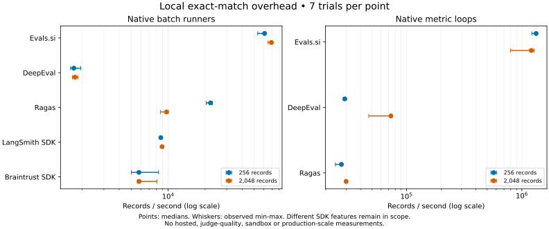

# Competitor benchmarks, 2026-10-18

**112 local timing trials passed, with zero scoring errors or missing rows.**
These measure deterministic Python evaluation overhead on a shared 3-CPU
Linux x86-64 workspace, not overall product capability, hosted-service speed,
judge quality, agent success or production-scale throughput.

The measured code is [`c975420`](https://github.com/Abhishek-Rnjn/Evals.si/commit/c975420).
The benchmark began from a clean tree, using Python **3.12.14** for every tool.
Each tool has its own version-locked environment. Seven fresh-process trials
per tool/tier/size ran serially in shuffled order, after a 12-record warmup.
The normal local servers and builds were stopped before collection. The
machine has about 10 GiB RAM; it is not a dedicated, clock-controlled host.

Every trial validates every record's score/ID, complete coverage, finite scores,
and matching corpus/result hashes across tools. Outbound connections and
hosted uploads are disabled; network attempts fail the child, including SDK
exit hooks. These data incur no model/API calls. Full methods and repeat
commands are in the [benchmark guide](../../tests/benchmarks/README.md).

## Native batch runners

The timer includes native input construction, evaluation, result collection
and conversion to per-record score pairs. Every runner uses concurrency one
and precomputed outputs. LangSmith/Braintrust also require an identity task.
Import/setup and warmup are excluded. Local bookkeeping differs: Evals.si
builds its manifest and intervals, DeepEval keeps test-run bookkeeping, and
Braintrust's public `Eval` retains progress/summary handling captured through
pipes. This is not an equal-feature or equal-persistence comparison.

| Tool / version | 256 records: median records/s | 2,048 records: median records/s | 2,048-record batch median (observed range), ms |
| --- | ---: | ---: | ---: |
| Evals.si source / 0.2.0.dev0 | 60,893 | 69,314 | 29.55 (29.24–31.48) |
| DeepEval 4.3.1 | 1,708 | 1,748 | 1,171.81 (1,111.78–1,230.96) |
| Ragas 0.4.3 | 22,101 | 9,682 | 211.53 (203.62–236.32) |
| LangSmith SDK 0.14.11, local uploads off | 8,716 | 8,921 | 229.57 (223.82–231.61) |
| Braintrust SDK 0.46.1, `no_send_logs` | 5,781 | 5,806 | 352.73 (252.95–365.29) |

Only this workload and machine are measured. The result establishes lower
Evals.si overhead for these local runner calls, not that its hosted platform,
metrics, or model judgments outperform the others. Small batches and cheap
metrics especially expose orchestration overhead; model latency would change
the relative contribution substantially.

## Native metric loops

Native inputs are prepared before timing. These numbers exclude the batch
runner, dataset conversion, manifests and gates. They include constructing
the score pairs. LangSmith/Braintrust custom equality callbacks are omitted
from this tier because they would just time Python equality.

| Tool | 256 records: median records/s | 2,048 records: median records/s | 2,048-record loop median (observed range), ms |
| --- | ---: | ---: | ---: |
| Evals.si `EvaluatorDef.fn` | 1,328,648 | 1,208,064 | 1.70 (1.60–2.57) |
| DeepEval `measure` | 29,196 | 73,289 | 27.94 (27.58–43.50) |
| Ragas collections `score` | 27,298 | 29,981 | 68.31 (67.48–69.41) |

Timing inputs are nonempty strings without leading/trailing whitespace, with
case changes, internal whitespace/newlines, Unicode composition and 4-KiB
strings. The score contract agrees over this shared domain. Evals.si's usual
normalization is explicitly disabled.

## Observed compatibility differences

The separate compatibility run records **50 outcomes**: ten cases per real
batch SDK. Unsupported inputs remain rejected, rather than counted as zero.

| Case | Evals.si (`normalize=False`) | DeepEval 4.3.1 | Ragas | LangSmith callback | Braintrust callback |
| --- | --- | --- | --- | --- | --- |
| Leading space / trailing newline | 0 | 1 (trims ends) | 0 | 0 | 0 |
| Empty output and empty reference | 1 | Rejected: `MissingTestCaseParamsError` | 1 | 1 | 1 |
| Empty output, nonempty reference | 0 | Rejected: `MissingTestCaseParamsError` | 0 | 0 | 0 |

All five agree on the other observed cases. These are metric-contract
differences, not a universal quality ranking. The installed DeepEval behavior
differs from its [online whitespace description](https://deepeval.com/docs/metrics-exact-match),
so the installed version and observed controls determine the timing domain.
The LangSmith/Braintrust callbacks intentionally implement strict equality;
their SDKs are not credited with a built-in exact-match metric.

## Free and hosted platforms

The [LangSmith free allowances](https://www.langchain.com/pricing) and
[Braintrust pricing](https://www.braintrust.dev/pricing) still require an
authenticated workspace for persisted experiments. No such account/API key
is configured here. LangSmith's unauthenticated listing returned 401;
Braintrust's anonymous project listing returned 200 but did not establish
authenticated experiment access. No cloud benchmark is reported.

Free self-hosted **Phoenix 20.20.0** and **MLflow 3.17.0** did pass actual
trace ingestion, Evals.si connector mapping, score replacement and independent
persisted-score read-back. These are functional integration results in the
[runtime report](RUNTIME-VERIFICATION-2026-10-18.md), not hosted performance
measurements. Existing Langfuse verification is retained; its full stack was
not remeasured here.

A future hosted comparison must include equivalent upload, persisted scoring
and full result read-back, with region/tier/free allowance recorded. A local
SDK call or Evals.si unary `Evaluate` response cannot stand in for that path.
Judge-quality comparisons also need common labelled data, identical model
versions/prompts, and measured cost; no quality or price winner is claimed.

## Raw evidence and interpretation

- [Every timing trial and summary](data/runtime-2026-10-18/sdk-overhead.json).
- [Every compatibility case](data/runtime-2026-10-18/sdk-compatibility.json).
- [Runtime prerequisites](data/runtime-2026-10-18/preflight.json),
  [sandbox summary](data/runtime-2026-10-18/sandbox.json),
  [Go sandbox events including skips](data/runtime-2026-10-18/sandbox.jsonl),
  and [trace-store persistence](data/runtime-2026-10-18/trace-stores.json).

Raw records include wall/CPU/process time, setup time and peak process RSS.
RSS includes imports and warmup. The raw `p95_batch_seconds` field describes
seven **whole-batch trials**, not per-record p95 or a production tail estimate.
Observed ranges are not confidence intervals; repeat on customer hardware and
representative workloads before making capacity or purchasing decisions.

The full CPU/kind follow-up can run through the existing `ci` workflow with
`cpu_only=true` to skip provider-backed checks. CI outcomes are recorded on
the accompanying pull request. The manual KVM job is not
dispatched without a real labelled KVM runner, kernel and pinned image.
